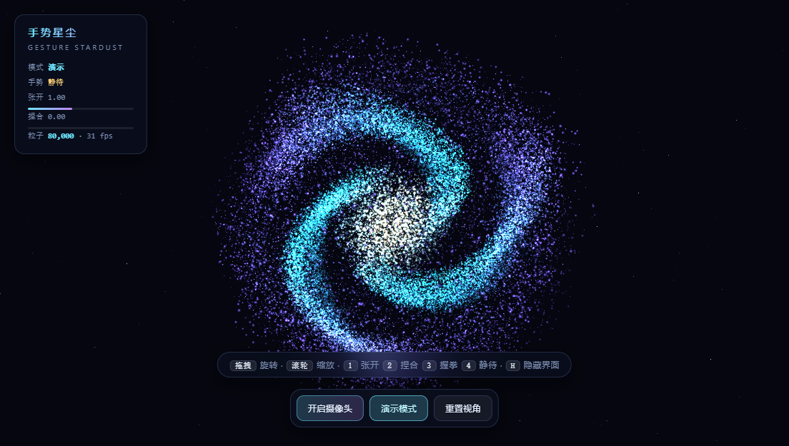
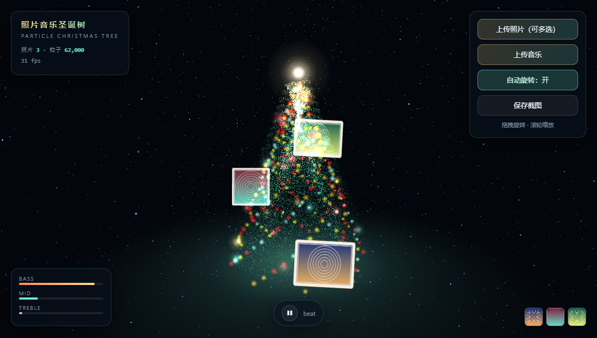
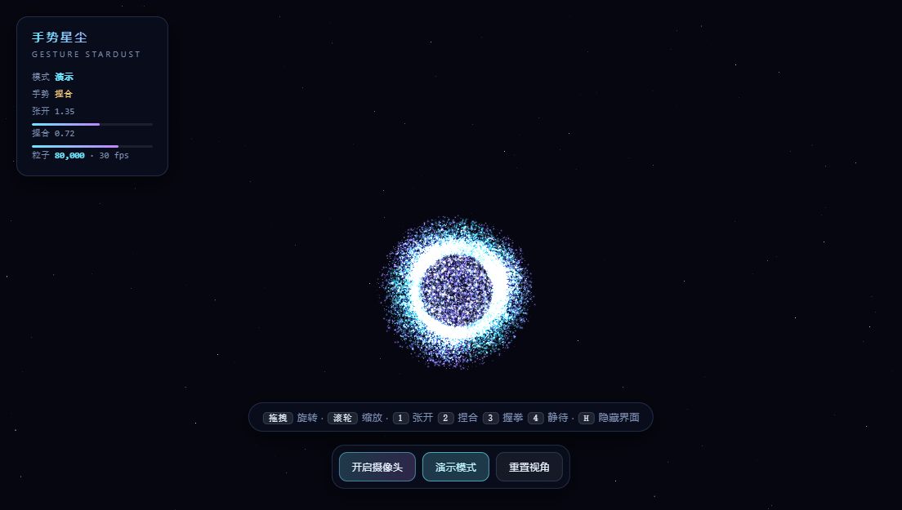
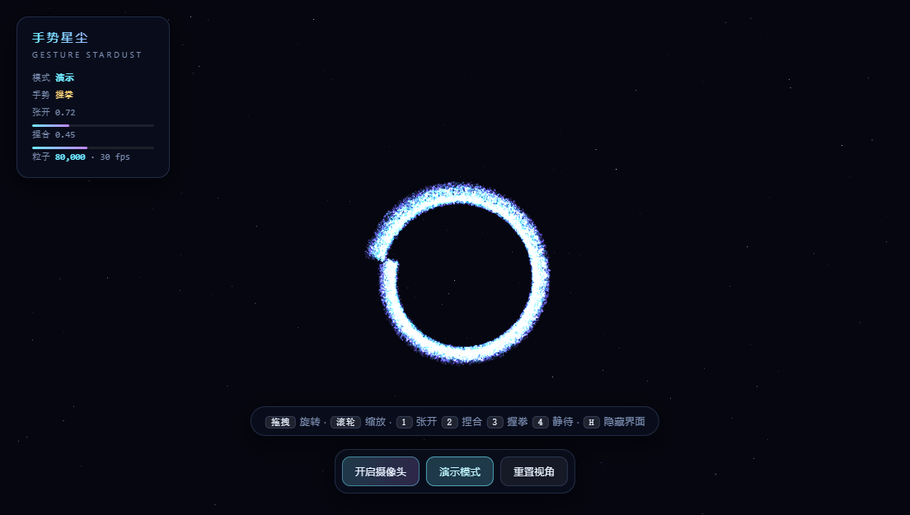
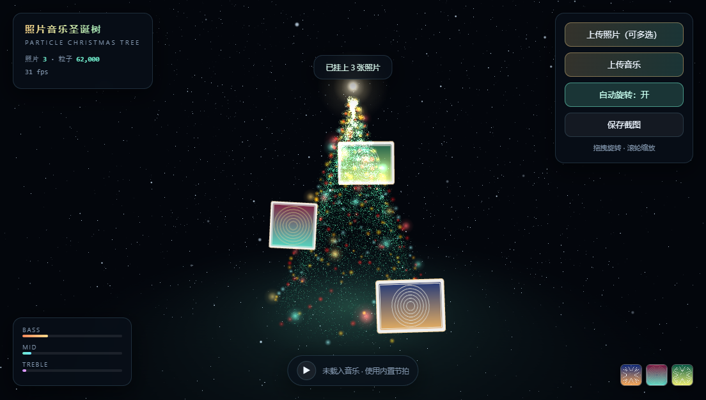

# 3D 粒子特效集

两个零构建、单文件即可运行的三维粒子特效，全部程序化生成，不加载任何模型或图片素材。

**在线体验**

| 作品 | 说明 |
|---|---|
| [手势星尘](gesture-stardust.html) | 摄像头识别手势，8 万星尘随张开 / 捏合 / 握拳聚散 |
| [照片音乐圣诞树](christmas-tree.html) | 上传照片挂上树身，上传音乐让整棵树随节拍呼吸 |

站点走 HTTPS，所以**摄像头手势在手机上也能用**（浏览器只在 https / localhost 下授予摄像头权限）。

## 手势星尘

点「开启摄像头」并授权，首次会从 CDN 下载手势模型（约 22MB，带进度提示）。

| 手势 | 判定依据 | 效果 |
|---|---|---|
| 张开手掌 | 指尖到掌心平均距离 ÷ 掌宽 > 1.62 | 星尘从掌心爆散成星云 |
| 捏合 | 拇指尖到食指尖距离 ÷ 掌宽 < 0.42 | 向掌心坍缩成发光能量球 |
| 握拳 | 张开度 < 0.92 | 收束成旋转光环 |
| 平移手掌 | 掌心坐标 | 星尘被拖出尾流 |

没有摄像头也能完整演示（默认就是演示模式，HUD 标「演示」）：

| 操作 | 作用 |
|---|---|
| 移动鼠标 / 滑动手指 | 掌心位置 |
| `1` `2` `3` `4`，或底部「张开 / 捏合 / 握拳 / 静待」 | 切换四种形态 |
| 拖拽 | 旋转视角 |
| 滚轮 / 双指 | 缩放 |
| `R` | 重置视角 |
| `H` | 隐藏界面 |

## 照片音乐圣诞树

| 操作 | 说明 |
|---|---|
| 上传照片（可多选） | 最多 24 张，自动生成白框金边相框，沿树身螺旋挂载并始终朝向相机 |
| 上传音乐 | 低频驱动树体脉动、中频驱动灯串、高频驱动雪花与树顶星芒 |
| 保存截图 | 导出当前画面为 PNG |
| 拖拽 / 滚轮 | 旋转 / 缩放 |

未载入音乐时会用内置合成节拍顶上，画面不会静止。

## 实现要点

- **three.js r160**，从 jsdelivr → unpkg → npmmirror 三级 CDN 动态 import 兜底。
- **全部运动在顶点着色器里算**：CPU 每帧只更新几个 uniform（吸引点、张开度、捏合度、频谱三段能量），8 万粒子不遍历。
- **不用 `examples/jsm`**：相机轨道手写，辉光靠 `AdditiveBlending` + 软圆片元，省掉 `OrbitControls`、`EffectComposer` 等额外模块请求。
- **纹理全部 Canvas 生成**：树顶星芒、地面光晕、相框描边、粒子软圆，零图片资源。
- **手势**：MediaPipe `tasks-vision` 的 HandLandmarker，21 关键点 → 掌心 / 张开度 / 捏合度，0.12s 指数平滑 + 0.09s 滞回防抖。
- **降级**：无摄像头或拒绝授权 → 自动切鼠标演示模式；CDN 全挂 → 错误卡片说明原因，不白屏。

## 浏览器要求

支持 WebGL2 的现代浏览器（Chrome / Edge / Firefox / Safari 16+）。摄像头手势需要 HTTPS 或 localhost。
